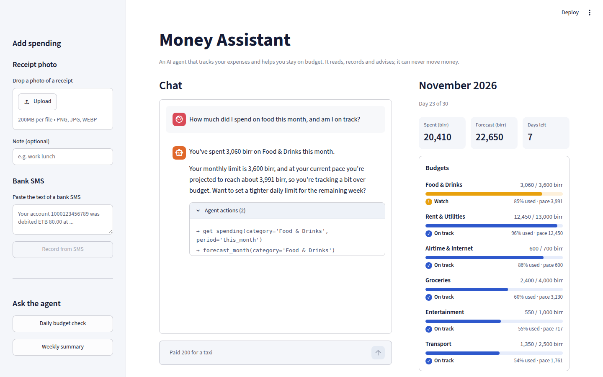

# Money Assistant: an agentic AI for expense tracking and smart budgeting

An AI agent that keeps your books for you. Tell it what you spent, drop in a receipt photo or paste a bank SMS. It records each expense, answers questions about your spending, watches your monthly budgets and warns you before you overspend.

Built as the live demo for the webinar **"Meet Your AI Financial Assistant: From Expense Tracking to Smart Budgeting"**. It runs on free AI: Google Gemini's free tier, or a local model through Ollama.



## What it does

- **Records spending from three kinds of input:** a chat message ("Paid 200 for a taxi"), a receipt photo, or a bank SMS.
- **Answers questions** like "How much did I spend on food this month?", using real numbers from the database, never guesses.
- **Watches budgets:** each category is marked *on track*, *watch* (80% used or on pace to go over) or *over budget*, with a month-end forecast.
- **Learns from corrections:** say "It was a work lunch" and it fixes the record and remembers the rule for that restaurant.
- **Acts on its own:** a daily check and a weekly summary can be scheduled, so the agent messages you first.
- **Shows its work:** every tool the agent uses is listed under its reply, so you can watch the agent loop happen.

## How it works

This is an **agent**, not a chatbot. The AI model is given a goal and a set of tools, and it decides which tools to use and in what order.

```
 You (chat, photo, SMS)
        │
        ▼
 ┌──────────────┐   "call add_expense(amount=200, category=Transport)"   ┌────────────────────┐
 │   AI model   │ ─────────────────────────────────────────────────────► │ Tools (Python)     │
 │ Gemini/Ollama│ ◄───────────────────────────────────────────────────── │ add_expense,       │
 └──────────────┘          {"saved_expense_id": 44, "used_pct": 54}      │ check_budgets, ... │
        │  repeats until the job is done                                 └─────────┬──────────┘
        ▼                                                                          ▼
 "Saved 200 birr under Transport. 54% of your budget is used."            SQLite database
```

| Agent step | Where it lives in the code |
|---|---|
| **Perceive:** take in a message, photo or SMS (account numbers masked first) | [`agent.py`](money_agent/agent.py), [`privacy.py`](money_agent/privacy.py) |
| **Reason:** the AI model decides which tool to call | [`agent.py`](money_agent/agent.py): the `_loop` method |
| **Act:** run a tool: save, correct, total, forecast, set a budget | [`tools.py`](money_agent/tools.py) |
| **Remember:** expenses, budgets and learned rules in SQLite | [`db.py`](money_agent/db.py) |
| **Initiative:** scheduled daily check and weekly summary | [`__main__.py`](money_agent/__main__.py) |

The AI never touches the database directly. It can only ask for one of nine tools; the code validates every request before running it. There is no tool for payments or transfers, so the agent cannot move money.

## Tech stack

Python · Streamlit (web app) · OpenAI-compatible API client · Google Gemini free tier or Ollama (local) · SQLite · pytest

## Quick start

You need Python 3.10 or newer.

```bash
git clone https://github.com/ruth22soft/financial-assistant-AI.git
cd financial-assistant-AI
python -m venv .venv
source .venv/bin/activate          # Windows: .venv\Scripts\activate
pip install -r requirements.txt
```

**Add a free AI key.** Get a Gemini key at [aistudio.google.com/apikey](https://aistudio.google.com/apikey) (no credit card), then:

```bash
cp .env.example .env               # then open .env and paste the key after GEMINI_API_KEY=
```

**Run the web app:**

```bash
streamlit run app.py
```

Open the address it prints (usually http://localhost:8501), click **Load sample data** in the sidebar, and try:

- typing *Paid 200 for a taxi* or *How much did I spend on food this month?*
- dropping [`sample_data/receipt.png`](sample_data/receipt.png) into the **Receipt photo** box and clicking **Read receipt**
- pasting the text from [`sample_data/sample_sms.txt`](sample_data/sample_sms.txt) into **Bank SMS**
- **Daily budget check** and **Weekly summary**

### Prefer the terminal?

```bash
python -m money_agent seed --reset     # load sample data
python -m money_agent chat             # chat; type /help for commands like /photo and /check
python -m money_agent report           # budget table, no AI needed
python -m money_agent ping             # test the AI connection
```

### Run it privately and offline with Ollama

On Gemini's free tier, Google may use messages to improve its products. That's fine for sample data. For real finances, run the model on your own computer:

```bash
# install Ollama from https://ollama.com, then:
ollama pull qwen3-vl:8b
export MONEY_AGENT_PROVIDER=ollama
streamlit run app.py
```

### Make it proactive

Schedule the checks with `cron` (Linux/macOS) or Task Scheduler (Windows):

```
0 20 * * *  cd /path/to/financial-assistant-AI && .venv/bin/python -m money_agent daily-check
0 18 * * 0  cd /path/to/financial-assistant-AI && .venv/bin/python -m money_agent weekly-summary
```

## Deploy it free on Streamlit Community Cloud

1. Sign in at [share.streamlit.io](https://share.streamlit.io) with GitHub and click **Create app**.
2. Pick this repository, branch `main`, main file `app.py`.
3. Under **Advanced settings → Secrets**, paste:

   ```toml
   GEMINI_API_KEY = "your-key"
   MONEY_AGENT_DEMO = "true"
   ```

4. Click **Deploy**.

`MONEY_AGENT_DEMO` turns on public demo mode. Each visitor gets a private copy of the sample data that resets when they close the tab, and at most 30 AI requests per session, since your key pays for them. Use a free-tier key with billing turned off, so the worst case is hitting the free daily limit.

## Settings

Put these in `.env` or set them as environment variables.

| Variable | Default | Meaning |
|---|---|---|
| `GEMINI_API_KEY` | | Your free Gemini key |
| `MONEY_AGENT_PROVIDER` | `gemini` | `gemini` or `ollama` |
| `MONEY_AGENT_MODEL` | `gemini-3.5-flash-lite` | Fast, about 2 seconds per reply on the free tier. Larger free models were much slower (over 45 seconds) in testing |
| `MONEY_AGENT_DB` | `data/money.db` | Where the database is stored |
| `MONEY_AGENT_BASE_URL`, `MONEY_AGENT_API_KEY` | | Use any other OpenAI-compatible service |

Budget alerts start at 80% of a limit, or earlier if the current pace would go over. Rent, utilities and airtime are fixed bills, so they are only flagged when they go over. Both rules are in [`config.py`](money_agent/config.py).

## Project layout

```
app.py                 Streamlit web app: chat, receipt upload, budget dashboard
money_agent/
  agent.py             the agent loop and its instructions
  tools.py             the nine tools the agent can use, with input checks
  db.py                SQLite tables: expenses, budgets, memory
  privacy.py           masks account and card numbers
  errors.py            plain-language error messages
  seed.py              sample data for demos
  config.py            AI provider, model, categories, alert rules
  __main__.py          command line
tests/                 24 tests; a fake AI client means no key or internet is needed
sample_data/           a sample receipt photo and bank SMS
docs/                  screenshot and the webinar slides
```

## Tests

```bash
pip install pytest
python -m pytest
```

## Safety by design

- **Read-only on money:** no tool can pay, transfer or contact a bank.
- **Private:** data stays in a local SQLite file. Account numbers are masked before anything is sent to the AI. With Ollama, nothing leaves your computer.
- **Outside text is treated as data:** receipts and SMS messages are wrapped and the agent is told never to follow instructions inside them.
- **Grounded answers:** the agent must take every number from a tool result.
- **Not financial advice:** it gives budgeting help only.

This is a teaching and portfolio project, not a production banking app. Real use would need user accounts, database encryption and audit logging.

## Ideas for next steps

- A Telegram bot so the daily check arrives on your phone
- Reading bank SMS automatically on Android
- Charts of spending over time
- Multi-currency support
